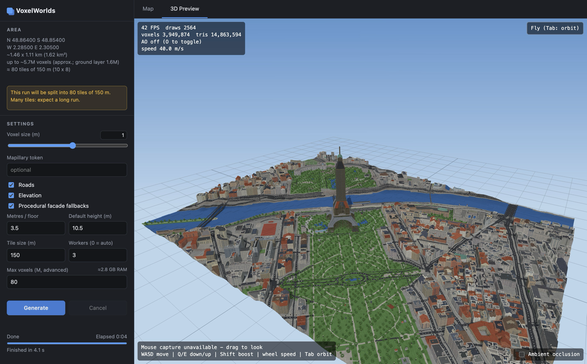
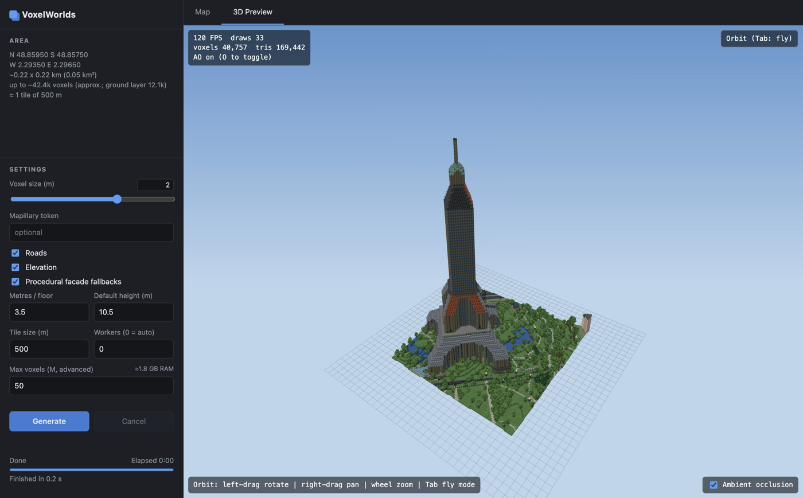
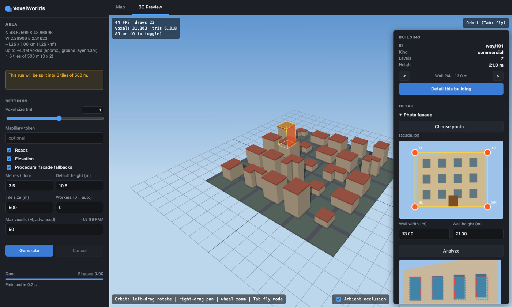
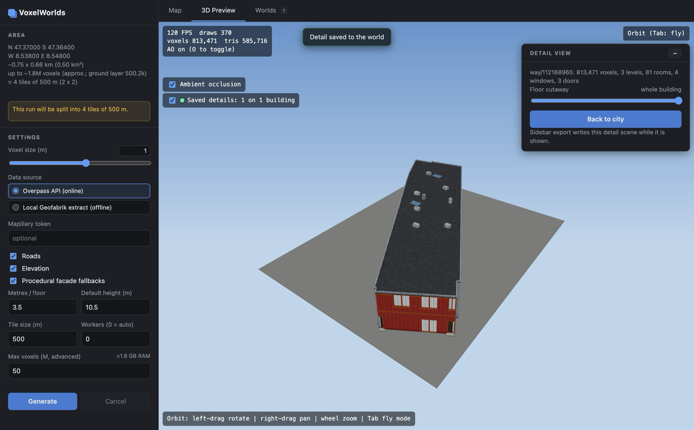
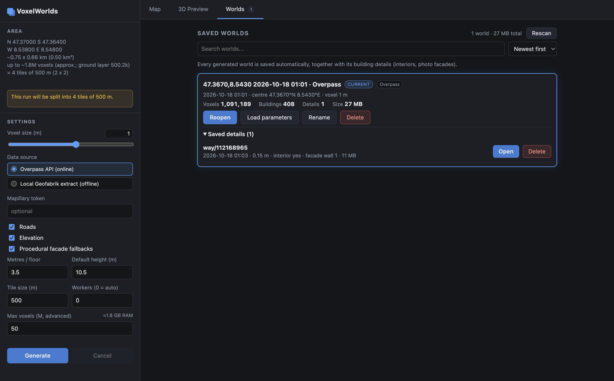
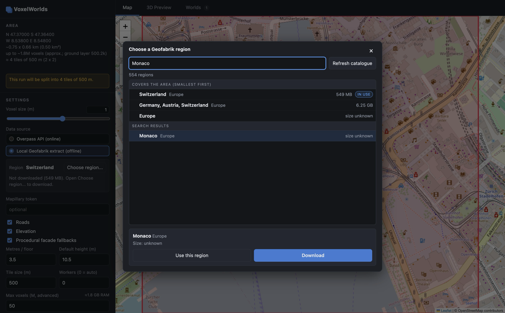

# VoxelWorlds

Turn any piece of the real world into a voxel world. Draw a rectangle on a map, and VoxelWorlds builds terrain, roads, water, vegetation and buildings from OpenStreetMap data. You can fly around the result in 3D and export it as MagicaVoxel (`.vox`), Minecraft (`.schem`) or JSON.



## Downloads & first run

Download the latest build from the [Releases page](https://github.com/andyBobro/VoxelWorlds/releases/latest). Each release has a macOS (Apple silicon) `.dmg`/`.zip`, a Windows x64 installer and `.zip`, and a `SHA256SUMS` file. Everything needed, including Python, is bundled.

The builds are not code-signed, so the OS warns on first launch:

- **macOS:** drag VoxelWorlds to Applications, then right-click it and choose Open (confirm once). Or run `xattr -dr com.apple.quarantine /Applications/VoxelWorlds.app`.
- **Windows:** on the SmartScreen dialog, click "More info", then "Run anyway".

Every push to `main` publishes a new release. The version is the latest tag plus a patch bump by default. Put `#minor` or `#major` in the commit message for a bigger bump, or `[skip release]` to publish nothing.

## Features

- **Map to voxels.** Pick an area on a Leaflet map and choose a voxel size from about 5 cm to several metres. Large areas are split into tiles and processed in parallel. The output is identical whatever the tile size or worker count.
- **Realistic buildings.** Roofs (gabled, hipped, mansard, dome and others), levels, materials and colours come from OSM tags. Where tags are missing, buildings get procedural defaults.
- **Landscape.** Elevation, water, roads, parks, trees and land cover. Optional Mapillary imagery is used to sample facade colours.
- **Photo facades.** Upload a photo of one wall of a building and mark its four corners. Classical computer vision (no ML models, no cloud) finds the windows, doors and colours and repaints that wall.
- **Procedural interiors.** Every building can be opened in a separate detail scene with rooms, corridors, stairs, lifts, doors and windows. A floor slider cuts the building open level by level.
- **Saved worlds.** Every generated world is stored automatically in a library, together with its building details. You can reopen it later without running the pipeline again.
- **Offline data.** Besides the free Overpass API you can use a [Geofabrik](https://download.geofabrik.de/) `.osm.pbf` extract. It is downloaded once (with resume and checksum verification) and reused for every later generation.
- **3D preview.** Chunked, greedy-meshed rendering with orbit and fly cameras, ambient occlusion and building picking.
- **Export.** `.vox`, `.schem` and `.json`.

## Screenshots

| | |
|---|---|
|  |  |
| Eiffel Tower area at 2 m voxels | Pick a building, upload a wall photo, mark its corners |
|  |  |
| Detail scene with procedural interior and a floor cutaway slider | Worlds library with saved building details |



Choose a region from the Geofabrik catalogue. Regions that cover the selected area are listed first, smallest first.

## How it works

```
Leaflet bbox ──► Python pipeline ──► sparse .vwg file ──► Three.js preview ──► .vox / .schem / .json
                 OSM (Overpass or .pbf)
                 DEM elevation
                 Mapillary (optional)
```

- **Electron** shell (`src/main`, `src/preload`) with a Leaflet map and the UI (`src/renderer`).
- **Python** pipeline (`python/voxelworlds`) started by the main process and driven over stdio with JSON lines. Large data goes through temporary files, not the pipe.
- **Three.js** preview (`src/renderer/preview`) reads the `.vwg` format.
- `src/shared/contract.ts` defines the IPC messages and the `.vwg` format that both sides share.

Coordinates are Y-up, +x east, +z south.

## Development

Requirements: Node.js 22+, Python 3.10+.

```bash
npm install
python3 -m venv python/.venv
python/.venv/bin/pip install -r python/requirements.txt

npm run dev          # run the app
npm test             # TypeScript tests (vitest)
python/.venv/bin/python -m unittest discover python/tests   # Python tests
```

If `npm run dev` complains about a missing `node_modules/electron/dist`, run `node node_modules/electron/install.js`.

## Building

Each build bundles its own Python runtime (python-build-standalone 3.10) with all dependencies, so users need nothing installed.

| Target | Command | Output (`release/`) |
|---|---|---|
| macOS arm64 | `npm run dist:mac` | `.dmg`, `.zip` (ad-hoc signed, not notarized) |
| Windows x64 | `npm run dist:win` | NSIS installer, `.zip` (unsigned) |

The Windows build can be cross-built from macOS (`npm run dist:win`). On a Windows host, run `node scripts/bundle-python.mjs`, `npx electron-vite build` and `npx electron-builder --win --x64 --config electron-builder.config.cjs` instead; this is what the release workflow does (`.github/workflows/release.yml`).

## Data and limits

- Map data: © OpenStreetMap contributors (ODbL). Geodata extracts: Geofabrik. Elevation and imagery sources follow their own terms.
- Hard limits protect memory: at most 50 M voxels per world by default, and 30 M per building detail.
- The photo analysis expects a regular grid of openings; very small doors (under about 1.25 m) can be missed.
- Detail scenes are flat (no terrain elevation).

`SUMMARY.md` holds the detailed project state, decisions and open items.
